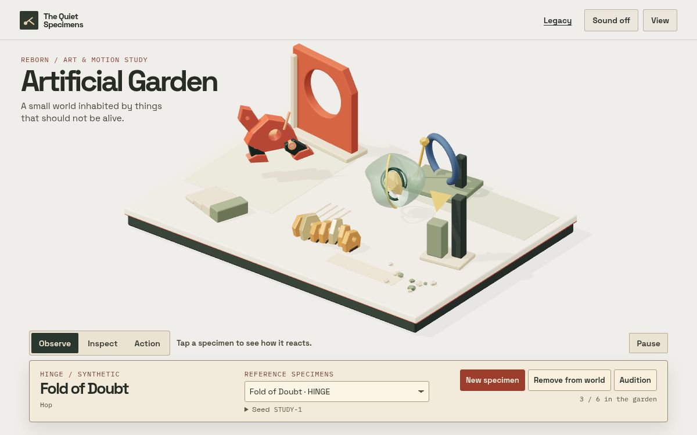

# The Quiet Specimens — Reborn

**Phase A · Art & Motion Study**

生きているはずのない物体が、自分の意思で動いているように見える小さな庭園です。関節で踏ん張る **HINGE**、殻の中に別の運動を持つ **VESSEL**、動きが節へ順番に伝わる **RELAY** に、3体ずつの参照個体を用意しました。



## 起動

Node.js 22.12 以上と npm を使用します。

```sh
npm ci
npm run dev
npm test
npm run build
```

開発時は Vite が表示する URL を開きます。静的ホスティングには `dist/` を配信します。ビルド済みの確認には `npm run preview` を使います。

## 操作

- **Observe** で複数の個体が暮らす庭園を眺めます。個体をクリックまたはタップすると、選択した個体が反応します。
- **Reference specimens** から9体を選べます。**New specimen** で新規生成し、**Seed** を開いて同じシードを入力すると個体を再生成できます。
- **Inspect** は回転・拡大、**Action** は身構えや回復を含むアクションの確認です。**Add to world** と **Remove from world** で最大6体を入れ替えられます。
- **Sound on** と **Audition** は、選択した1体の音を聴く操作です。**View** は鑑賞用に操作欄を隠します。**Pause** は動きを止めます。
- **Legacy** は同じ配信元の `/legacy/` にある従来版です。写真からの生成、コレクション、JSON 入出力、既存の IndexedDB 保存にアクセスできます。

## 構成

| パス | 内容 |
| --- | --- |
| `src/reborn` | 庭園、体型レジストリ、材質、固定刻みの運動、鑑賞 UI |
| `src/legacy` | アクアリウムと旧研究室 |
| `src/audio` | 両エントリーが使う Web Audio ボイスと発音スケジューラー |
| `src/core`, `src/genesis`, `src/archive` | シード、従来の生成・画像解析、保存スキーマ |

Phase A は WebGL 2 を使います。新しい庭園の配置はセッション内で扱います。新しい個体の画像解析・収集やワールド保存は [ロードマップ](docs/ROADMAP.md) に記載しています。

- [Reborn art direction](docs/ART_DIRECTION_REBORN.md)
- [Body plans](docs/BODY_PLANS.md)
- [Motion design](docs/MOTION_DESIGN.md)
- [Verification](docs/VERIFICATION.md)
